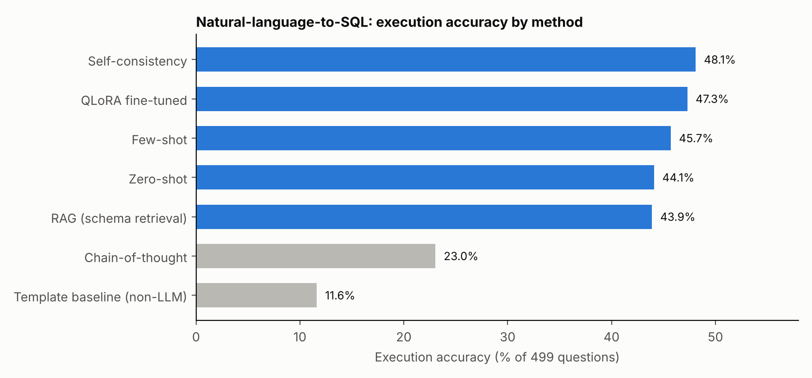
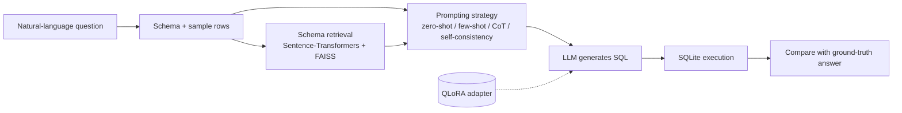

# NLQuery: natural-language questions over tables, answered with LLM-generated SQL

Can an open-source LLM answer plain-English questions about structured data by writing SQL? This project compares prompting strategies, schema-aware retrieval (RAG) and a LoRA fine-tune on the same evaluation set, scoring each by whether the generated SQL **executes to the correct answer**. DATA 266 (Generative AI) group project, San José State University.

**Team:** Vrushabh Bodarya, Jenil Savalia and Mahak Gupta.

## Results

Each method was scored on the same evaluation subset of 500 questions (499 scored).

| Method | Execution accuracy | SQL validity | Avg latency / question |
|---|---|---|---|
| Self-consistency | **48.1%** (240/499) | not recorded | 6.08 s |
| QLoRA fine-tuned | 47.3% (236/499) | **89.8%** | 2.23 s |
| Few-shot | 45.7% (228/499) | 87.4% | 1.89 s |
| Zero-shot | 44.1% (220/499) | 83.0% | 1.94 s |
| RAG (schema retrieval) | 43.9% (219/499) | 83.4% | 1.93 s |
| Chain-of-thought | 23.0% (115/499) | 41.7% | 14.62 s |
| Template baseline (non-LLM) | 11.6% (58/499) | 62.5% | 0.001 s |

What the numbers say:

- Every LLM approach beats the template baseline by a wide margin, so most of the gain comes from using a code-capable model at all.
- Self-consistency (sampling several answers and voting) is the most accurate, but it costs about 3x the latency of a single call.
- The QLoRA fine-tune is within one point of self-consistency at roughly a third of its latency, and has the highest SQL validity of any method.
- Chain-of-thought hurt: at 23.0% it is far below zero-shot, and it is also the slowest at 14.6 s per question. Only 41.7% of its outputs were valid SQL.
- Schema-retrieval RAG did not beat plain zero-shot here (43.9% vs 44.1%).
- The gaps between zero-shot, few-shot, RAG and fine-tuning are a few points on 499 questions, so they are suggestive rather than conclusive.

## Pipeline

## Fine-tuning setup

| Setting | Value |
|---|---|
| Base model | `Qwen/Qwen2.5-Coder-7B-Instruct` |
| Method | LoRA adapter trained with QLoRA (PEFT 0.18.1) |
| Rank / alpha / dropout | 8 / 16 / 0.05 |
| Target modules | `q_proj`, `v_proj` |

## Metrics

- **Execution accuracy**: the generated SQL runs and returns the ground-truth answer.
- **SQL validity**: the generated SQL runs without error.
- **Latency**: average seconds per question.

Raw numbers are in [`results/metrics.csv`](results/metrics.csv); [`make_chart.py`](make_chart.py) regenerates the chart.

## Notes

- The per-method result files do not record which base model the prompting runs used, and the self-consistency run did not record SQL validity.
- The experiment notebook, evaluation subset and adapter weights are not included here yet; this repository currently holds the results and write-up.
- The original project proposal listed four datasets (Adult Income, Wine Quality, Heart Disease and WikiTableQuestions) with a plan for prompting, RAG and optional LoRA experiments.
